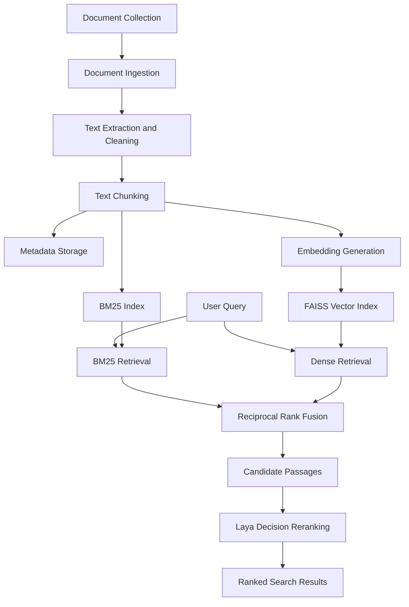

# Local-Laya-RAG
### A Local Hybrid Retrieval-Augmented Generation Pipeline with Laya-Based Decision Reranking

<p align="center">

**Building smarter document retrieval through hybrid search and decision-based reranking.**

</p>

<p align="center">


</p>

---

## Overview

**Local-Laya-RAG** is a local document retrieval and ranking system designed to improve the quality of search results using a combination of traditional lexical search, dense vector retrieval, Reciprocal Rank Fusion (RRF), and Laya-based decision reranking.

The project explores how multiple retrieval strategies can work together to identify the most relevant passages from a document collection.

Instead of relying on a single retrieval method, Local-Laya-RAG combines:

- **BM25** for keyword-based information retrieval.
- **Dense Retrieval** for semantic similarity search.
- **FAISS** for efficient vector similarity search.
- **Reciprocal Rank Fusion (RRF)** for combining retrieval rankings.
- **Laya** for comparing candidate passages and selecting the most relevant result.

The goal is to build a practical, lightweight, and locally runnable retrieval pipeline that can be evaluated and improved systematically.

## Key Features

| Feature | Description |
|---|---|
| Document ingestion | Extract and process text from supported documents |
| Text preprocessing | Normalize and split documents into manageable chunks |
| BM25 retrieval | Retrieve passages using lexical relevance |
| Dense retrieval | Find semantically similar passages using embeddings |
| FAISS indexing | Perform efficient vector similarity search |
| Hybrid retrieval | Combine BM25 and dense rankings using RRF |
| Laya reranking | Compare candidate passages using decision-based selection |
| Streamlit interface | Interact with the retrieval pipeline through a web interface |
| Evaluation | Measure retrieval quality using standard ranking metrics |
| Local execution | Run the application using a local Python environment |

---

## System Architecture

The retrieval pipeline follows a modular architecture.



### Retrieval Workflow

**1. Document ingestion**

Documents are loaded and their text is extracted for processing.

**2. Text preprocessing**

Extracted content is normalized and divided into smaller chunks. Each chunk receives an identifier and associated metadata.

**3. Lexical retrieval**

BM25 retrieves passages based on keyword matching and term relevance.

**4. Semantic retrieval**

A sentence-transformer embedding model converts document chunks and queries into vector representations. FAISS searches for semantically similar passages.

**5. Hybrid retrieval**

The BM25 and dense retrieval rankings are combined using Reciprocal Rank Fusion.

The RRF score is calculated as:

\[
RRF(d)=\sum_{r \in R}\frac{1}{k+rank_r(d)}
\]

Where:

- \(d\) represents a document passage.
- \(R\) represents the retrieval systems.
- \(rank_r(d)\) represents the passage rank in retrieval system \(r\).
- \(k\) is the RRF smoothing constant.

**6. Laya decision reranking**

The fused candidate passages are passed to Laya. Laya compares the candidates against the query and selects the most relevant passage according to the configured decision criteria.

**7. Final results**

The application displays the retrieved passages, ranking information, and available confidence information.

---

## Technology Stack

| Technology | Purpose |
|---|---|
| Python 3.11 | Core programming language |
| Laya | Decision-based passage reranking |
| Sentence Transformers | Dense text embeddings |
| FAISS | Vector similarity search |
| BM25 | Lexical information retrieval |
| SQLite | Document and metadata storage |
| Streamlit | Interactive application |
| NumPy | Numerical operations |
| Pytest | Automated testing |

---

## Project Structure

```text
Local-Laya-RAG/
│
├── app.py
├── config.py
├── requirements.txt
├── README.md
├── .env.example
├── .gitignore
├── pytest.ini
│
├── jevrank/
│   ├── __init__.py
│   ├── ingestion.py
│   ├── laya.py
│   ├── rank.py
│   ├── search.py
│   └── store.py
│
├── evaluation/
│   ├── __init__.py
│   ├── evaluate.py
│   └── queries.json
│
├── tests/
│   ├── __init__.py
│   ├── test_core.py
│   ├── test_store.py
│   └── test_eval.py
│
└── data/
    ├── documents/
    └── cache/
```

### Core Modules

- `ingestion.py` — Document loading, text extraction, normalization, and chunking.
- `store.py` — SQLite-based metadata and chunk storage.
- `search.py` — BM25 and dense retrieval.
- `rank.py` — Hybrid retrieval and Reciprocal Rank Fusion.
- `laya.py` — Laya-based candidate comparison and reranking.
- `app.py` — Streamlit application interface.
- `evaluate.py` — Retrieval evaluation and ranking metrics.

---

## Installation

### Prerequisites

- Python 3.11
- Git
- Windows, Linux, or macOS
- Internet access for installing dependencies and downloading required models initially

### 1. Clone the repository

```bash
git clone https://github.com/Ommane-16/Local-Laya-RAG.git
cd Local-Laya-RAG
```

### 2. Create a virtual environment

Windows:

```cmd
py -3.11 -m venv .venv311
.venv311\Scripts\activate
```

Linux / macOS:

```bash
python3.11 -m venv .venv311
source .venv311/bin/activate
```

### 3. Install dependencies

```bash
python -m pip install --upgrade pip
pip install -r requirements.txt
```

### 4. Run tests

```bash
python -m pytest -q
```

### 5. Start the application

```bash
streamlit run app.py
```

Open the local URL displayed in your terminal to access the application.

---

## Usage

### Document Retrieval

1. Start the Streamlit application.
2. Upload a supported document.
3. Allow the ingestion pipeline to extract and process the text.
4. Submit a search query.
5. Retrieve candidate passages using BM25 and dense search.
6. Combine the rankings using RRF.
7. Apply Laya-based decision reranking.
8. Inspect the final ranked passages.

The system is designed to help identify relevant information in a document collection without requiring a separate answer-generation model.

---

## Evaluation Framework

Retrieval quality is an important part of this project.

Local-Laya-RAG includes an evaluation pipeline for comparing retrieval strategies.

### Retrieval Strategies

| Strategy | Description |
|---|---|
| BM25 | Lexical retrieval baseline |
| Dense | Semantic retrieval baseline |
| Hybrid | BM25 and dense retrieval combined using RRF |
| Hybrid + Laya | Hybrid retrieval followed by Laya decision reranking |

### Evaluation Metrics

**Precision@K**

Measures the proportion of retrieved passages in the top K results that are relevant.

\[
P@K=\frac{\text{Relevant passages in top K}}{K}
\]

**Recall@K**

Measures the proportion of all known relevant passages retrieved in the top K results.

\[
R@K=\frac{\text{Relevant passages in top K}}{\text{Total relevant passages}}
\]

**Mean Reciprocal Rank (MRR)**

Measures how highly the first relevant result appears.

\[
MRR=\frac{1}{|Q|}\sum_{q \in Q}\frac{1}{rank_q}
\]

**Normalized Discounted Cumulative Gain (nDCG@K)**

Measures ranking quality while accounting for the position of relevant results.

The evaluation queries and relevance judgments are maintained in:

```text
evaluation/queries.json
```

For meaningful evaluation, relevance judgments must be populated with manually verified relevant passage IDs.

Run the evaluation pipeline using:

```bash
python -m evaluation.evaluate
```

### Benchmarking Objective

The main experimental objective is to investigate whether adding Laya-based decision reranking to hybrid retrieval improves the ordering of relevant passages compared with BM25, dense retrieval, and hybrid retrieval alone.

No performance improvement is assumed without measured benchmark results.

---

## Design Considerations

### Why Hybrid Retrieval?

Lexical and semantic retrieval have complementary strengths.

- BM25 performs well when queries contain important keywords or exact terminology.
- Dense retrieval helps identify semantically related passages even when wording differs.
- Hybrid retrieval combines both retrieval signals to improve candidate coverage.

### Why Laya?

Laya provides a decision-based approach to comparing candidate passages.

Rather than treating the original retrieval score as the final ranking, the system uses Laya to make a selection among candidate passages based on the query and configured criteria.

Laya's choice probabilities and confidence outputs should be interpreted as model decision information, not as calibrated probabilities of passage relevance.

### Why Local Execution?

A local setup provides:

- Control over document storage.
- A reproducible Python environment.
- Flexibility for experimentation.
- Reduced dependence on external application infrastructure.

Model downloads and dependency installation may still require internet access.

---

## Current Scope and Limitations

Local-Laya-RAG is an experimental retrieval and reranking project.

Current scope:

- Document ingestion and chunking.
- BM25 retrieval.
- Dense vector retrieval.
- FAISS-based similarity search.
- Hybrid ranking with RRF.
- Laya-based candidate reranking.
- Streamlit-based interaction.
- Retrieval evaluation.

Current limitations:

- Retrieval quality depends on document quality and chunking strategy.
- Ambiguous queries may produce weak or irrelevant results.
- Laya reranking depends on the quality of the candidate pool.
- Choice probabilities should not be interpreted as calibrated relevance scores.
- Evaluation quality depends on reliable relevance annotations.
- The project does not currently provide a complete generative question-answering pipeline.

---

## Future Improvements

Potential future directions include:

- Improved chunk filtering and document-quality detection.
- Better handling of table-of-contents and index passages.
- Query preprocessing and ambiguity detection.
- Retrieval thresholding and no-match handling.
- More comprehensive benchmark datasets.
- Additional reranking experiments.
- Retrieval latency and resource-consumption analysis.
- Improved Streamlit visualization and result inspection.

---

## Research and Learning Objectives

This project provides a practical environment for exploring:

- Information retrieval.
- Semantic search.
- Hybrid search architectures.
- Vector databases and similarity search.
- Reciprocal Rank Fusion.
- Decision-based reranking.
- Retrieval evaluation.
- Experimental comparison of ranking methods.

The broader objective is to understand how retrieval and reranking components can be combined to produce more useful search results from local document collections.

---

## Contributing

Contributions, suggestions, and improvements are welcome.

For substantial changes:

1. Fork the repository.
2. Create a feature branch.
3. Implement and test your changes.
4. Submit a pull request describing the improvement.

---

## Author

**Ommane-16**

GitHub: [@Ommane-16](https://github.com/Ommane-16)

Project: [Local-Laya-RAG](https://github.com/Ommane-16/Local-Laya-RAG)

---

## License

This project is distributed under the MIT License.

If you intend to publish it under MIT, include a corresponding `LICENSE` file in the repository.

---

<p align="center">

**Local-Laya-RAG**

*Exploring better retrieval through hybrid search and decision-based reranking.*

</p>
